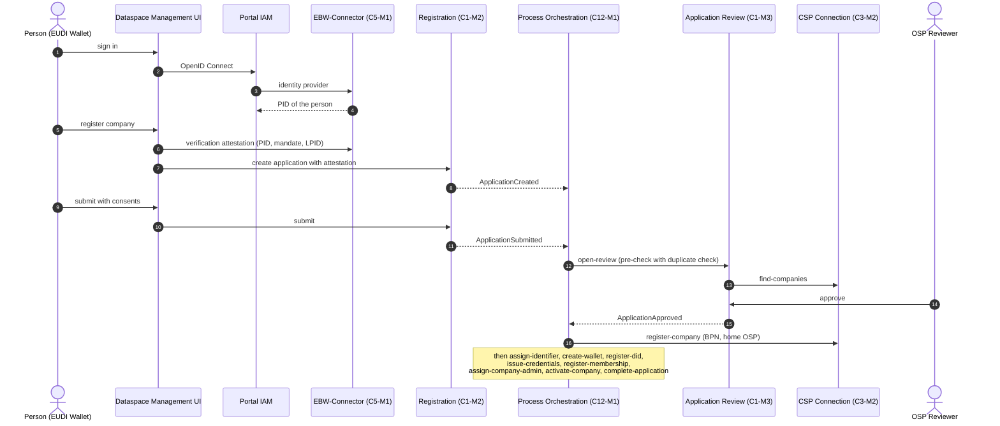

# 6. Runtime view

## 6.1 Onboarding of a company with Business Wallet

The most important flow (FRAMEWORK 5.2). Every step after the submission runs through Process Orchestration and is
event-driven.

## 6.2 Further flows

The framework of the specification describes the other flows across modules: admission of an OSP, people of a company,
deactivation and reactivation of a company, transfer to another OSP, technical users with wallet access, app approval and
subscription, and connectors in the discovery. Process Orchestration runs all of them from `flows.yaml`.

## NOTICE

This work is licensed under the [CC-BY-4.0](https://creativecommons.org/licenses/by/4.0/legalcode).

- SPDX-License-Identifier: CC-BY-4.0
- SPDX-FileCopyrightText: 2026 Contributors to the Eclipse Foundation
- Source URL: https://github.com/eclipse-tractusx/dataspace-mgm-service/blob/main/docs/architecture/06_runtime_view.md
